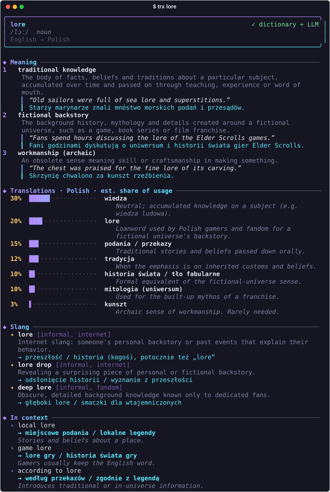

<div align="center">

# trx

**English words and phrases, explained and translated in your terminal.**

Uses any OpenAI-compatible LLM. Definitions and pronunciation come from a real dictionary when it has an entry.




</div>

---

## Why

Online translators give you one word back. trx shows **what a word means, how people actually translate it, and when to use each option**:

- **Meanings**: every sense, with an example sentence translated
- **Translations**: ranked by estimated share of real-world use
- **Slang**: informal uses, each tagged with its register
- **In context**: idiomatic vs. literal translations, tone, collocations

Every result shows where its content came from:

| Badge | Meaning |
|---|---|
| `✓ dictionary + LLM` | Senses, IPA and part of speech come from a [Wiktionary-backed dictionary](https://dictionaryapi.dev); the LLM writes explanations and translations from those senses. |
| `◇ LLM only` | No dictionary entry (common for phrases and idioms), so the whole result is model output. |

## Install

Requires Python 3.8+ (standard library only), a truecolor terminal, and an API key for any OpenAI-compatible endpoint: OpenAI, OpenRouter, Groq, or a local Ollama / LiteLLM / LM Studio server.

```sh
git clone https://github.com/andrzejsantocki/trx.git
cd trx && ./install.sh     # copies trx to ~/.local/bin
trx                        # opens the setup menu
```

In the menu, set the **Base URL**, **API key** (typed hidden) and **Model**, then press `t` to test the connection.

<details>
<summary>Example endpoints</summary>

| Provider | Base URL | Example model |
|---|---|---|
| OpenAI | `https://api.openai.com/v1` | `gpt-4o-mini` |
| OpenRouter | `https://openrouter.ai/api/v1` | `anthropic/claude-3.5-haiku` |
| Groq | `https://api.groq.com/openai/v1` | `llama-3.3-70b-versatile` |
| Ollama (local) | `http://localhost:11434/v1` | `llama3.1` |

</details>

**Optional:** add `alias tr=trx` to `~/.bashrc`. The alias only affects interactive shells, so scripts still get the system `tr`.

## Usage

```sh
trx lore                   # a word
trx get over that          # a phrase
trx -l German lore         # different target language, this call only
trx --json lore            # raw JSON, for scripts
trx                        # menu: key, URL, model, language, theme, test
trx --test                 # check endpoint, key and model
trx -- -ish                # "--" ends options, so text can start with "-"
```

## Themes


```sh
trx --themes               # preview all themes
trx --theme nord           # save as default
trx --theme dracula lore   # use for one call only
```

Output is plain text when piped or when `NO_COLOR=1` is set.

## Configuration

Settings live in `~/.config/tr/env`, mode `0600`, written atomically by the menu. Values in this file override `TR_*` shell variables.

| Key | Purpose | Default |
|---|---|---|
| `TR_BASE_URL` | OpenAI-compatible endpoint | — |
| `TR_API_KEY` | API key, or `${ENV_VAR}` to reference one | — |
| `TR_MODEL` | Model id | — |
| `TR_LANG` | Target language | `Polish` |
| `TR_THEME` | Color theme | `default` |
| `TR_FALLBACK_URL` | Second endpoint, tried if the first fails | — |
| `TR_TIMEOUT` | Request timeout in seconds | `90` |
| `TR_NO_DICT` | `1` turns off the dictionary lookup | — |

To keep the key out of the file, reference an environment variable instead:

```sh
TR_API_KEY=${OPENAI_API_KEY}
```

## How it works

```
input ─┬─▶ dictionaryapi.dev ─▶ senses, IPA, part of speech ─┐
       │                                                    ▼
       └──────────────────────────────▶ LLM (JSON output) ──▶ merge ─▶ render
```

1. Looks up the input in the dictionary (8 s timeout; a miss or network error falls back to LLM only).
2. Sends the LLM a structured prompt. Any dictionary senses are included and marked authoritative.
3. Overrides the model's IPA and part of speech with the dictionary's when an entry exists.
4. Draws the result to fit your terminal width, in your chosen theme.

## Accuracy and privacy

- Usage percentages are **model estimates**, not corpus counts.
- Translations, slang and context examples are **LLM output** and can contain mistakes.
- Your input is sent to dictionaryapi.dev and to your configured LLM endpoint. Set `TR_NO_DICT=1` to skip the dictionary.
- Your API key stays on your machine, in `~/.config/tr/env`.

## Development

```sh
python3 test_trx.py        # offline self-checks: config, masking, themes, rendering
```

The whole tool is one dependency-free file: [`trx`](trx).

## License

[MIT](LICENSE)
